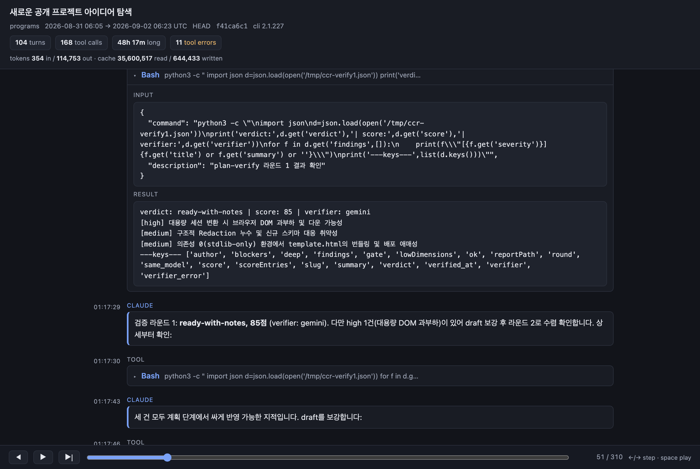

# cc-replay

Turn a Claude Code session transcript into a single self-contained HTML timeline you can scroll, replay and share.

## 한눈 요약

- Claude Code 가 남기는 `.jsonl` 세션 기록을 **HTML 파일 한 개**로 바꿔주는 CLI 입니다. 사람이 읽을 수 있는 타임라인으로 재구성합니다.
- 설치할 것이 없습니다. Python 3.9 이상이면 되고 **외부 의존성이 0개** 입니다 (표준 라이브러리만 사용).
- 바로 실행: `python3 -m cc_replay --latest` → 가장 최근 세션이 `replay.html` 로 저장됩니다.
- 결과물은 완전한 단독 파일입니다. CDN·폰트·이미지 등 **외부 요청을 전혀 하지 않아** 인터넷 없이 열립니다.
- **비밀정보 마스킹이 기본 ON** 입니다. API 키·토큰·이메일·홈 경로 등을 자동으로 가립니다.
- 다만 마스킹은 패턴 기반이라 **완벽하지 않습니다**. 공유 전에 반드시 결과 파일을 직접 확인하세요.
- 재생 컨트롤(재생/한 단계씩/스크러버), 도구 호출 접기, 서브에이전트 들여쓰기, 다크·라이트 테마를 지원합니다.

## What it is

Claude Code records every session as a JSON Lines file under `~/.claude/projects/`. Those files
are a faithful record and almost impossible to read: one long line per event, tool calls separated
from their results, subagent work interleaved with the main thread.

cc-replay reads one of those files and writes a single HTML document that reconstructs the session
as a vertical timeline — user turns, assistant replies, thinking blocks, tool calls paired with
their results, and subagent runs nested under the tool call that spawned them.



## Why

A transcript is the most detailed record of how a piece of work actually happened, and it is
usually thrown away because nobody can read it. cc-replay makes it reviewable: for understanding
what an agent did, for sharing a debugging session with a colleague, or for keeping a readable
artifact of a long piece of work.

## Quickstart

Requires **Python 3.9+**. There are **no dependencies** — standard library only.

```sh
git clone https://github.com/oh-namgyu/cc-replay.git
cd cc-replay
python3 -m cc_replay --latest
```

That converts your most recent session and writes `replay.html` in the current directory.
Open it in any browser.

```sh
python3 -m cc_replay --list                        # see recent sessions
python3 -m cc_replay path/to/session.jsonl         # convert a specific file
python3 -m cc_replay --latest -o ~/Desktop/s.html  # choose the output path
```

## CLI reference

| Flag | Default | Description |
| --- | --- | --- |
| `path` | — | Path to a `.jsonl` transcript. Optional if `--latest` or `--list` is given. |
| `--latest` | off | Use the most recently modified transcript found under the projects directory. |
| `--list` | off | Print the 20 most recent sessions (modified time, size, project, session id) and exit. |
| `-o`, `--output` | `replay.html` | Where to write the HTML. Parent directories are created. |
| `--no-redact` | off | Disable redaction. The page is then marked with a loud "unredacted" badge. |
| `--max-events N` | `5000` | Keep only the last N timeline steps. Older steps are dropped and counted. |
| `--version` | — | Print the version and exit. |
| `-h`, `--help` | — | Show usage and exit. |

Transcripts are looked up in `~/.claude/projects/`. If the `CLAUDE_CONFIG_DIR` environment
variable is set, that directory is used instead of `~/.claude`.

Exit codes: `0` on success, `2` when the transcript does not exist, when `--latest` or `--list`
finds no sessions, or on a usage error.

## Features

- **Timeline** — user, assistant, thinking, system and tool steps in order, each with its timestamp
  (shown in UTC, so a shared replay reads the same for everyone).
- **Tool call pairing** — each `tool_use` is matched with its `tool_result` by id and rendered as a
  collapsed row: tool name plus a one-line summary (the command for `Bash`, the file path for
  `Read`/`Write`/`Edit`). Expanding shows the full input and result. Errors get a red accent, and a
  call whose result never arrived is marked "no result" rather than silently dropped.
- **Subagent nesting** — sidechain steps are nested under the tool call that spawned them, with an
  indented connector.
- **Playback** — a fixed bottom bar with step back / play-pause / step forward, a scrubber and a
  step counter. Steps after the cursor dim; stepping scrolls the current step into view and flashes
  it. Arrow keys step, space plays. Playback is opt-in: the page opens with the whole session
  visible.
- **Markdown** — assistant and user text renders fenced code blocks, inline code, bold, italic,
  headings and lists. Text is HTML-escaped before any transform, so nothing in a transcript can
  inject markup. Links are produced only for `http`/`https` URLs; images are left as literal text
  and never load.
- **Dark and light themes** — follows the reader's `prefers-color-scheme`.
- **Self-contained** — CSS, JS and the session data are inlined, including the favicon. The page
  makes no network requests of any kind.
- **Handles large sessions** — a 93 MB / 12,140-line transcript converts in about 1.3 seconds into a
  6.8 MB page whose 4,470 steps finish rendering in under 200 ms.

Oversized payloads are truncated at parse time (50,000 characters or 1,000 lines per block) with a
visible marker, so one enormous tool result cannot make the page unusable.

## Security & redaction

**Redaction is ON by default.** Before the session is written into the page, values are masked in
two passes: once across the parsed session tree, and once over the serialized JSON as a safety net.

Covered pattern categories:

- **API keys and tokens** — Anthropic (`sk-ant-…`), OpenAI-style (`sk-…`), GitHub (`ghp_`, `gho_`,
  `ghu_`, `ghs_`, `ghr_`, `github_pat_…`), Slack (`xox[abprs]-…`), AWS access key ids (`AKIA…`),
  Google API keys (`AIza…`)
- **`Bearer` tokens** in authorization values
- **Generic assignments** — `api_key`, `token`, `secret`, `password`, `passwd`, `authorization`
  followed by `=` or `:` (only the value is masked)
- **JWTs** — `eyJ….eyJ….…`
- **Private key blocks** — `-----BEGIN … PRIVATE KEY-----` through the matching `END`
- **Email addresses**
- **Home paths** — `/Users/<name>` and `/home/<name>` become `~`, `C:\Users\<name>` becomes
  `%USERPROFILE%`, and the bare account name is masked wherever else it appears

> **Redaction is best effort, not a guarantee.** It is pattern-based: a secret in a shape not listed
> above will pass straight through. **Review the generated HTML before sharing it.**

Passing `--no-redact` writes the session verbatim. Pages produced that way carry a prominent
"⚠ unredacted" badge in the footer.

The output HTML embeds your prompts, the assistant's replies and full tool output. Treat it as
sensitive as the session itself.

## Transcript compatibility

Verified against transcripts written by **Claude Code v2.1.227**.

The transcript format is undocumented and changes between releases, so the parser is deliberately
forgiving. Event types it does not recognize are preserved as collapsed raw-JSON blocks instead of
being dropped or raising, lines that fail to parse are skipped and counted, and a truncated final
line (a session still being written) is handled without error. A newer Claude Code should therefore
still produce a readable replay, with anything unfamiliar visible as a raw block.

## Development

No build step and no dependencies. Run the test suite with the standard library:

```sh
python3 -m unittest discover -s tests -v
```

76 tests cover transcript parsing, redaction, the CLI and the rendered page. They run on Python 3.9
through 3.12 and use synthetic fixtures only — no real transcript is ever read by a test.

## License

MIT — see [LICENSE](LICENSE).
